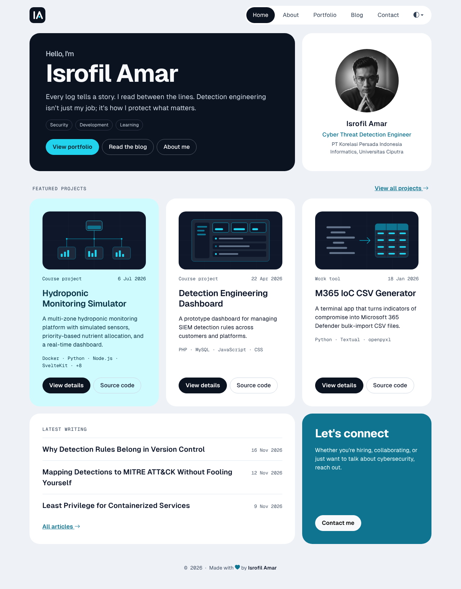
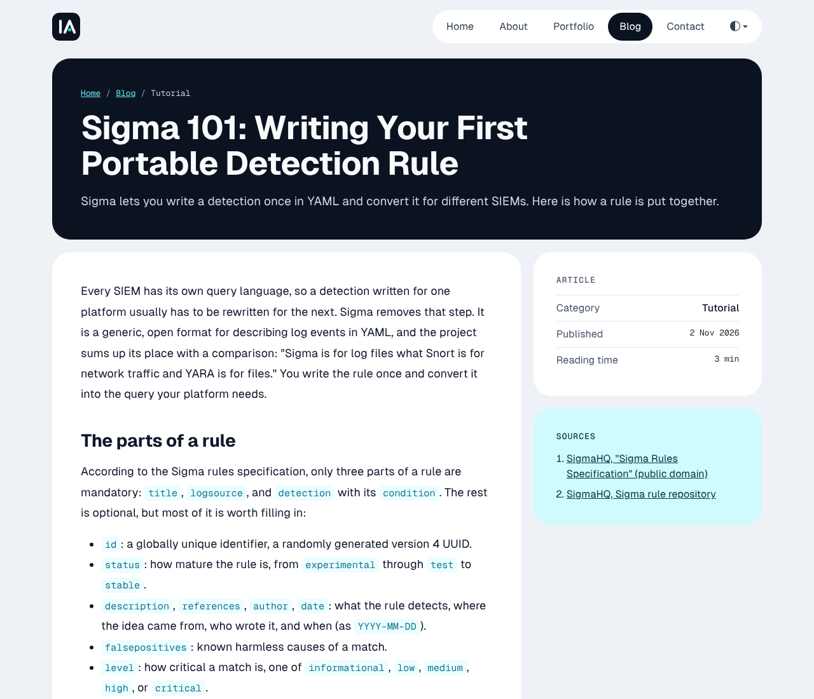
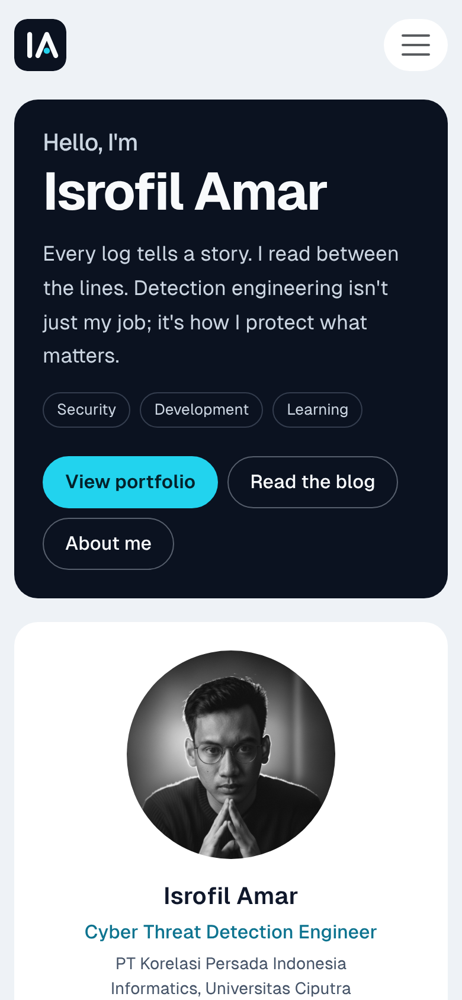
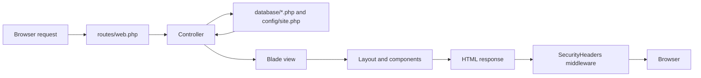

# personal-web

Personal website of Isrofil Amar, a cyber threat detection engineer, built with Laravel 13, Blade, and Bootstrap 5.3.



| Blog article (desktop) | Home page (phone) |
| --- | --- |
|  |  |

## Features

- **Home**: name, role, tagline, focus areas, featured projects, latest articles, and links to Portfolio, Blog, and About.
- **About**: profile, background, skills, experience, education, and certifications.
- **Portfolio**: four projects, each with an illustration, description, technologies, and a detail page.
- **Blog**: five articles with category, date, excerpt, and a detail page with reading time, sources, and related articles. Article bodies are written in Markdown.
- **Contact**: email address and professional profiles.
- **Theme**: light, dark, or auto (follows the operating system), chosen from the navigation bar and remembered in the browser.
- **Custom 404 page** for unknown URLs and unknown slugs.
- Responsive layout from phone to desktop, with a skip link and visible keyboard focus.

## Tech stack

| Area | Choice |
| --- | --- |
| Language | PHP 8.3 or newer |
| Framework | Laravel 13 with Blade templates |
| CSS framework | Bootstrap 5.3.9 and Bootstrap Icons 1.13.2, loaded from jsDelivr with Subresource Integrity |
| Fonts | Geist Sans and Geist Mono, self-hosted in `public/fonts` |
| Styles and scripts | Plain CSS in `public/css/style.css` and plain JavaScript in `public/js/theme.js`, no build step |
| Content | PHP arrays in `database/` and `config/site.php` (no database needed) |
| Tests and style | PHPUnit, Laravel Pint |

## Getting started

### Requirements

- PHP 8.3 or newer (the dependency lock file targets PHP 8.3)
- Composer

No database, Node.js, or npm is needed.

### Install and run

```bash
git clone https://github.com/srflmr/personal-web.git
cd personal-web
composer install
cp .env.example .env
php artisan key:generate
php artisan serve
```

Open http://127.0.0.1:8000 in a browser.

### Run the checks

```bash
php artisan test
./vendor/bin/pint --test
```

## Project structure

```text
app/Http/Controllers/          HomeController, PortfolioController, BlogController
app/Http/Middleware/           SecurityHeaders (response security headers)
bootstrap/app.php              registers SecurityHeaders for every response
config/site.php                name, role, tagline, email, navigation, social links
database/dummyportfolios.php   portfolio projects (PHP array, newest first)
database/dummyblogs.php        blog articles (PHP array, Markdown bodies, newest first)
docs/screenshots/              images used in this README
public/css/style.css           design tokens, tile layout, light and dark themes
public/js/theme.js             light, dark, and auto theme switcher
public/fonts/                  Geist Sans and Geist Mono (woff2) and their license
public/images/                 profile photo, certification badges, illustrations
resources/views/layout/        default.blade.php, the shared page layout
resources/views/components/    navbar, footer, section-heading, portfolio-card, blog-card
resources/views/               home, about, contact, portfolio/, blog/, errors/404
routes/web.php                 seven named GET routes
```

## Laravel features map

| Feature | Where it is used |
| --- | --- |
| Routing | `routes/web.php`: named routes, `Route::group` with `prefix` and `controller` for Portfolio and Blog, slug parameters constrained with `->where('slug', '[a-z0-9-]+')` |
| Controllers | `app/Http/Controllers/HomeController.php`, `PortfolioController.php`, `BlogController.php`: load the content arrays, find items by slug, return 404 for unknown slugs, and pass data to the views |
| Views and Blade | `resources/views/`: `{{ }}` output, `@foreach`, `@forelse`, `@if` / `@elseif` / `@else`, `@isset`, `@unless`, `@empty`, `@class` |
| Layout | `resources/views/layout/default.blade.php` with `@yield`; every page starts with `@extends('layout.default')` and fills `@section('title')` and `@section('content')` |
| Components | Anonymous components in `resources/views/components/` with `@props`, used as `<x-navbar>`, `<x-footer>`, `<x-section-heading>`, `<x-portfolio-card>`, and `<x-blog-card>` |

Output of `php artisan route:list --except-vendor`:

```text
 GET|HEAD / .. home › HomeController@index
 GET|HEAD about .. about › HomeController@about
 GET|HEAD blog .. blog.index › BlogController@index
 GET|HEAD blog/{slug} .. blog.show › BlogController@show
 GET|HEAD contact .. contact › HomeController@contact
 GET|HEAD portfolio .. portfolio.index › PortfolioController@index
 GET|HEAD portfolio/{slug} .. portfolio.show › PortfolioController@show

 Showing [7] routes
```

## Architecture

The site follows Laravel's MVC structure. Version 1 has no models: content comes from PHP arrays, which keeps the site runnable without a database.



1. A route matches the URL and calls a controller method.
2. The controller loads the content array with `include base_path('database/<file>.php')`, finds the item by slug with a strict comparison, and calls `abort_if($item === null, 404)` when it is missing.
3. For articles, the controller renders the Markdown body with `Str::markdown()` and computes the reading time.
4. The view only displays the data it receives. It extends the shared layout and uses components for repeated parts.
5. The `SecurityHeaders` middleware adds the security headers to every response, including 404 pages.

Key names in the content arrays match the planned database columns, so moving content to MySQL changes the controllers but not the views or URLs.

## Security

- **Security headers** (`app/Http/Middleware/SecurityHeaders.php`, registered globally in `bootstrap/app.php`): `Content-Security-Policy`, `X-Frame-Options: DENY`, `X-Content-Type-Options: nosniff`, `Referrer-Policy: strict-origin-when-cross-origin`, `Permissions-Policy`, and `Cross-Origin-Opener-Policy: same-origin`. The `X-Powered-By` header is removed.
- **Content Security Policy without `unsafe-inline`**: scripts, styles, and fonts load only from the site itself and jsDelivr. The views contain no inline scripts, inline styles, or `style` attributes, and the theme switcher is the external file `public/js/theme.js`, which sets the theme before the first paint.
- **Output escaping**: all output uses `{{ }}`. The one exception is the article body, which is produced by `Str::markdown()` with `html_input => 'strip'` and `allow_unsafe_links => false`.
- **Input constraints**: slug parameters only accept `[a-z0-9-]+`, and unknown slugs return 404.
- **Third-party assets** are pinned to exact versions and loaded with `integrity` hashes. Fonts are self-hosted.
- **External links** that open in a new tab use `rel="noopener noreferrer"`.
- **Secrets**: `.env` is not committed, and `.env.example` contains no secrets.
- **HTTPS deployments** should also send `Strict-Transport-Security`. It is not set here because the local server runs over HTTP.

With `APP_DEBUG=true`, Laravel's error page may look unstyled because the Content Security Policy blocks its inline styles. This is expected.

## Development workflow

- `main` holds released versions only, and each release is tagged (`v1.0.0`). `develop` is the integration branch.
- Work happens on short-lived branches (`feat/*`, `fix/*`, `docs/*`, `chore/*`, `refactor/*`) created from `develop`.
- Every change reaches `develop` through a pull request that references its issue and is merged with a merge commit. Both protected branches block force pushes and deletion.
- Commit messages follow Conventional Commits.
- A release is a pull request from `develop` to `main`, followed by a GitHub Release that creates the tag.

The full conventions are in [CONTRIBUTING.md](CONTRIBUTING.md).

## AI assistance

Claude Code was used to scaffold the project, implement each pull request, review changes, write documentation, and draft the blog articles from the sources cited in each article. The author reviewed and approved each article. The author also reviewed every change, ran it locally, and merged it through a pull request. The conventions given to the assistant are in [CONTRIBUTING.md](CONTRIBUTING.md) and [CLAUDE.md](CLAUDE.md).

## Project context

Built as coursework for a web development course. v1.0.0 serves static content; v2.0.0 adds database-backed content management.

## Credits

- [Laravel](https://laravel.com/) (MIT License)
- [Bootstrap](https://getbootstrap.com/) and [Bootstrap Icons](https://icons.getbootstrap.com/) (MIT License)
- [Geist Sans and Geist Mono](https://vercel.com/font) by Vercel (SIL Open Font License 1.1, see [public/fonts/OFL.txt](public/fonts/OFL.txt))
- MITRE ATT&CK®, referenced in the article "Mapping Detections to MITRE ATT&CK Without Fooling Yourself": © 2026 The MITRE Corporation. This work is reproduced and distributed with the permission of The MITRE Corporation.
- Certification badge images belong to their issuing organizations.
